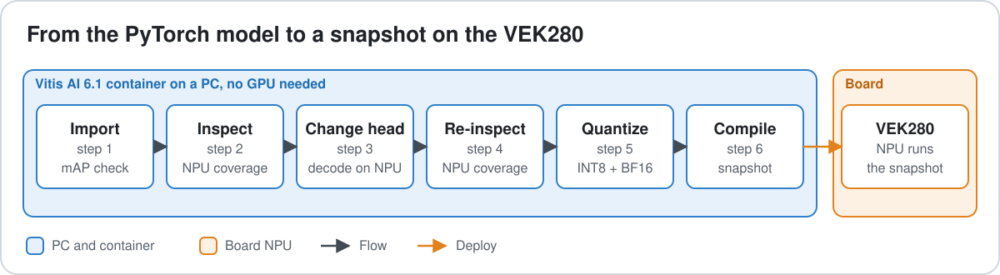

  
   
  <picture>
    <source media="(prefers-color-scheme: dark)" srcset="assets/logo-tiremo-vision-dark.svg">
    
  </picture>

<h1 align="center">YOLOv8s on the Versal NPU with Vitis AI 6.1</h1>

  <b>Versal AI Edge VEK280</b> 
  A step-by-step notebook that takes YOLOv8s to the NPU as a full-NPU snapshot

  
  
  
  

## Summary

This project is a worked example of the Vitis AI 6.1 flow. It takes the COCO YOLOv8s detector (80 classes, 640×640 input) and prepares it for the NPU (neural processing unit) of the AMD Versal VEK280 in one Jupyter notebook. The result is a mixed-precision snapshot that runs entirely on the NPU, and the accuracy is checked after every step. It is meant for engineers who want to bring their own detector to a Versal NPU, and all source code is included.

## Highlights

- The box decoding runs on the NPU too. Exported as is, the end of YOLOv8 stays on the CPU, so the notebook rewrites the detection head in operations the NPU has. The weights stay the same.
- The backbone and neck run in INT8, and the detection head and decode run in BF16, which is only 3.6 % of the MACs.
- The snapshot has one NPU subgraph and no CPU subgraph.
- Mixed precision reaches 0.405 mAP50-95 against 0.438 for FP32 on 2,000 COCO images.
- The whole flow runs in a Vitis AI container on a PC, and no GPU is needed.

## Specifications

| Category | Details |
|:--|:--|
| Use cases | learning the Vitis AI 6.1 flow, deploying a custom detector to a Versal NPU |
| Target markets | edge AI development, embedded vision |
| Platform | VEK280 evaluation board, Versal AI Edge VE2802 |
| Compute | AI Engine NPU (NPU IP `VE2802_NPU_IP_O00_A304_M1`) |
| Models and algorithms | YOLOv8s with 80 COCO classes at 640×640, INT8 for the backbone and neck, BF16 for the head and decode |
| Inputs | one 640×640 image |
| Outputs | one tensor of shape [1, 84, 8400]: box centre, width and height in input pixels, and 80 class scores per anchor point |
| Software and tools | Vitis AI 6.1, PyTorch, Ultralytics, ONNX Runtime, Python 3.11, uv |
| Data | COCO val2017, for calibration and for the mAP checks |

## System

1. Import the model and measure its prediction and mAP. Output: `result_export/`.
2. Inspect which parts run on the NPU. Output: `result_inspection/default/`.
3. Change the detection head so the decode uses NPU operations. Output: `result_export/`.
4. Inspect the changed model. Output: `result_inspection/npu_tail/`.
5. Quantize the model to INT8 and BF16 and score it on the emulated NPU. Output: `result_quantization/`.
6. Compile the model into the snapshot for the board. Output: `result_compilation/YOLOv8s_COCO.snapshot/`.

The notebook is `quantize_compile_yolov8s.ipynb`. `utils.py` holds its helper functions, and `vitis_ai/` is the code that runs inside the Vitis AI container.

## Performance

| Metric | Value | Conditions |
|:--|:--|:--|
| mAP50, FP32 | 0.599 | COCO val2017, 2,000 images |
| mAP50, mixed precision | 0.562 | same images, emulated NPU |
| mAP50-95, FP32 | 0.438 | same images |
| mAP50-95, mixed precision | 0.405 | same images, emulated NPU |
| NPU coverage | 1 NPU subgraph, 0 CPU subgraphs | Vitis AI 6.1 compile for `VE2802_NPU_IP_O00_A304_M1` |

## Development

The model is the pretrained COCO YOLOv8s from Ultralytics. The notebook first measures it as is, then checks which layers the NPU can run. The end of YOLOv8 (reshape, softmax and the box math) is not supported on the NPU, so even the mixed-precision setting leaves it on the CPU. The notebook rewrites the forward function of the detection head, per scale, in operations the NPU has, which moves the decode onto the NPU as well. After that the model is quantized and compiled into a snapshot.

A few things are worth knowing when you work with Vitis AI 6.1:

- The quantization is cached by model structure. Without `VAISW_QUANTIZATION_FORCE=true`, a retrained model with the same architecture gets the cached results of the previous one.
- Each run reuses its output buffers, so copy the results before the next image runs.
- The `BEFORE_LAST_CONV` setting loses small objects. It leaves the first box convolutions in INT8, and on objects under 16 pixels the rounding drops the IoU below 0.5. Moving the border with `VAISW_FE_MIXEDEXPLICITSELECTION` fixes it. The `fe.mixedSelection=TAIL` setting does not compile for this model.
- On the board, VART's Python runner crashes on non-contiguous input, so pass arrays made with `np.ascontiguousarray`.

## Setup

You need an Ubuntu PC with Docker, about 100 GB of free disk space and [uv](https://docs.astral.sh/uv/). No GPU is needed. [INSTALL.md](INSTALL.md) walks through the Vitis AI 6.1 container, the NPU IP, COCO, the Python environment and the YOLOv8s weights. It also explains how to run the snapshot on the VEK280.

After the installation, open the notebook with the project's `.venv` kernel and run all cells. `CALIB_SIZE` and `EVAL_SIZE` in the settings cell set the number of images, so use fewer for a quick run. The sample image shown at each step is `input.png` in this folder, with optional labels in `input.txt` in YOLO format. Put your own files there to try the flow on other images.

## Resources

- [VEK280 evaluation board](https://www.amd.com/en/products/adaptive-socs-and-fpgas/evaluation-boards/vek280.html): board overview and documentation
- [Versal AI Edge series](https://www.amd.com/en/products/adaptive-socs-and-fpgas/versal/ai-edge-series.html): the device family
- [Vitis AI documentation](https://vitisai.docs.amd.com/): from a trained model to the NPU
- [YOLOv8](https://docs.ultralytics.com/models/yolov8/): the detector family
- [COCO dataset](https://cocodataset.org/): the data used for calibration and mAP checks
- [uv](https://docs.astral.sh/uv/): the Python package manager used by the project

## Related demos

- [Air-to-All-Around Vision Tracking](../vek280-drone-vision-tracking/): a complete application that runs YOLOv8s on the same NPU
- [Air-to-Ground Surveillance](../alinx-z7a-air-to-ground-surveillance/): a YOLOv8s person detector running entirely on an NPU

## Third-party licenses

Ultralytics YOLOv8 (AGPL-3.0), the COCO dataset (CC BY 4.0) and AMD Vitis AI are used under their own licenses.

## Contact

Questions about this demo: [ai@empa.com](mailto:ai@empa.com)

Product names are trademarks of their respective owners. Last updated 2026-11.
