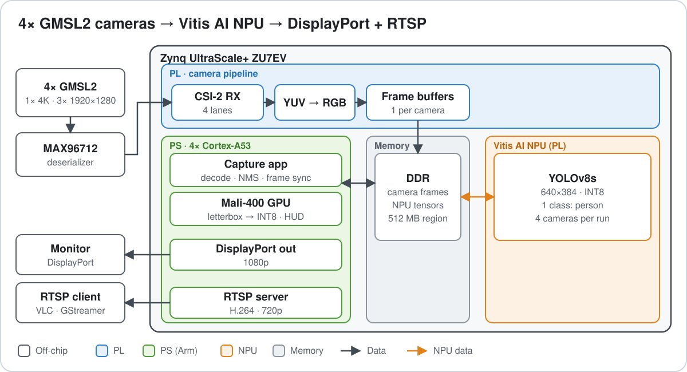

  
   
  <picture>
    <source media="(prefers-color-scheme: dark)" srcset="assets/logo-tiremo-vision-dark.svg">
    
  </picture>

<h1 align="center">Air-to-Ground Surveillance</h1>

  <b>ALINX Z7-A</b> 
  Four drone cameras, one person detector on the NPU and two live video outputs

  
  
  
  

<!-- TODO hero photo: the board with the cameras and the quad view on the monitor. Save as assets/hero.jpg, then un-comment.

  
   
  

-->

## Summary

Four GMSL2 cameras on a drone look at the ground below and stream into a single Zynq UltraScale+ ZU7EV over one 4-lane CSI-2 link. A YOLOv8s person detector runs entirely on the Vitis AI NPU (neural processing unit) in INT8. The results go out on DisplayPort and as a live H.264 RTSP stream, with every box drawn on the frame it was found in. One compact board handles capture, AI and streaming for airborne surveillance. On the screen, a quad view of the four cameras shows people boxed in real time, and any RTSP player such as VLC shows the same view.

## Highlights

- A MAX96712 deserializer brings four GMSL2 cameras onto a single CSI-2 link.
- All 8.56 GMAC of YOLOv8s run on the NPU in INT8, with no fallback to the Arm cores.
- The detector was trained on about 29,000 person images, from street level up to drone altitude.
- Every box is drawn on its own frame, on DisplayPort and in the RTSP stream.

## Specifications

| Category | Details |
|:--|:--|
| Use cases | air-to-ground person detection, live RTSP surveillance feed |
| Target markets | defence, security, UAV operations |
| Platform | ALINX Z7-A board, Zynq UltraScale+ ZU7EV |
| Compute | Vitis AI NPU in the programmable logic, 4× Arm Cortex-A53, Mali-400 GPU |
| Models and algorithms | YOLOv8s person detector (1 class) at 640×384 in INT8, 8.56 GMAC per inference |
| Inputs | 4× GMSL2 cameras (one 4K, three 1920×1280) through a MAX96712 deserializer, MIPI CSI-2 with 4 lanes at 2.5 Gbps |
| Outputs | DisplayPort at 1080p, H.264 RTSP stream at 720p |
| Software and tools | Vitis AI 6.1, GStreamer RTSP server |
| Data | about 29,000 person images, from street level to drone view |

## System

1. The four cameras feed the MAX96712, which sends all of them over one 4-lane CSI-2 link.
2. The CSI-2 receiver in the programmable logic converts YUV to RGB and writes one frame buffer per camera to DDR, with no load on the CPU.
3. The Mali-400 GPU letterboxes each frame to 640×384 and converts it to INT8, which keeps pixel work off the Arm cores.
4. The NPU runs YOLOv8s to find people. One run covers all four cameras as a quad view.
5. The Arm cores decode the boxes, filter them with NMS and match each one to its own frame.
6. The Arm cores and the GPU draw the overlay and send the result to DisplayPort at 1080p and as H.264 RTSP at 720p.

## Performance

| Metric | Value | Conditions |
|:--|:--|:--|
| Model on the NPU | 100 % of 8.56 GMAC | Vitis AI 6.1 compile, INT8, 640×384 input |
| Cameras per inference run | 4 | quad view of all four cameras |
| Outputs | DisplayPort at 1080p, RTSP at 720p | live, H.264 |

## Development

The camera pipeline in the programmable logic receives the four cameras over one CSI-2 link, converts their colour and writes one frame buffer per camera. YOLOv8s was trained on about 29,000 person images, then quantized to INT8 and compiled with Vitis AI 6.1 so that the whole network runs on the NPU. A single-class model keeps the detection head light. The capture application on the Arm cores connects capture, inference, frame sync and both outputs, and a GStreamer RTSP server publishes the stream.

A few points shaped the design:

- The network is compiled so that every operation maps to the NPU. A layer the NPU could not run would fall back to the Arm cores, with a round trip through DDR.
- Detections travel with their source frame, so each box always matches the picture on both outputs.
- Letterboxing and INT8 conversion run on the Mali-400 GPU, which leaves the Arm cores free for decoding and streaming.

## Setup

- ALINX Z7-A board, which runs the full pipeline
- Four GMSL2 cameras mounted on the drone and looking down, one 4K and three 1920×1280
- MAX96712 deserializer, which combines the four cameras onto one CSI-2 link
- Monitor on DisplayPort at 1080p
- PC with VLC or GStreamer as the RTSP viewer

## Resources

- [Zynq UltraScale+ MPSoC](https://www.amd.com/en/products/adaptive-socs-and-fpgas/soc/zynq-ultrascale-plus-mpsoc.html): the device family
- [MIPI CSI-2 Receiver Subsystem (PG232)](https://docs.amd.com/r/en-US/pg232-mipi-csi2-rx): the camera input IP
- [MAX96712](https://www.analog.com/en/products/max96712.html): the quad GMSL2 deserializer
- [Vitis AI documentation](https://vitisai.docs.amd.com/): from a trained model to the NPU
- [YOLOv8](https://docs.ultralytics.com/models/yolov8/): the detector family
- [GStreamer RTSP server](https://gstreamer.freedesktop.org/documentation/gst-rtsp-server/): the streaming library

## Related demos

- [Air-to-All-Around Vision Tracking](../vek280-drone-vision-tracking/): an AI drone that flies by its camera alone
- [ADAS Multi-Task Perception](../kv260-adas-multitask-perception/): five perception tasks in one network at 30 FPS
- [One PCIe Card, Many Accelerators](../deico-z7015-pcie-accelerator-switching/): FPGA accelerators swapped over PCIe in about 3 s

## Contact

Questions about this demo: [ai@empa.com](mailto:ai@empa.com)

Product names are trademarks of their respective owners. Last updated 2026-11.
