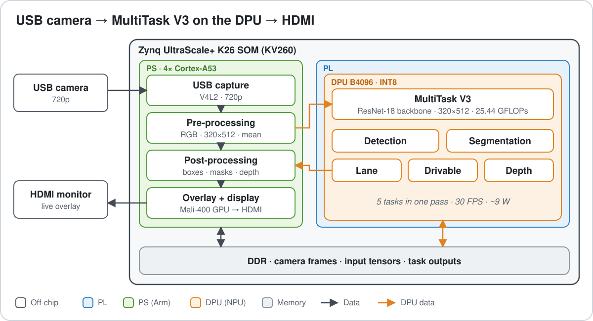

  
   
  <picture>
    <source media="(prefers-color-scheme: dark)" srcset="assets/logo-tiremo-vision-dark.svg">
    
  </picture>

<h1 align="center">ADAS Multi-Task Perception</h1>

  <b>Kria KV260</b> 
  One network runs five perception tasks at 30 FPS on about 9 W

  
  
  
  

<!-- TODO hero photo: the KV260 with the camera and the live overlay on the monitor. Save as assets/hero.jpg, then un-comment.

  
   
  

-->

## Summary

A single Vitis AI MultiTask V3 network runs five perception tasks at once on a 720p USB camera feed: object detection, semantic segmentation, lane segmentation, drivable-area segmentation and depth estimation. It runs on the DPU (deep-learning processing unit) of a Kria KV260 at 30 FPS on about 9 W, and the INT8 model keeps the accuracy of its FP32 original. Because the five tasks share one backbone, the approach suits vehicles with a tight power budget. An HDMI monitor shows the live overlay with objects, lanes, drivable area, segmentation and depth.

## Highlights

- Detection, three kinds of segmentation and depth come from a single forward pass.
- The network runs at 30 FPS on about 9 W, on the DPU B4096 of a Kria KV260.
- The INT8 model keeps FP32 accuracy, with 50.9 against 51.2 detection mAP.
- The demo was tested on day and night driving scenes.

## Specifications

| Category | Details |
|:--|:--|
| Use cases | traffic object detection, lane and drivable-area detection, depth estimation |
| Target markets | automotive, ADAS, smart mobility |
| Platform | Kria KV260 Vision AI Starter Kit, Zynq UltraScale+ K26 SOM |
| Compute | DPU B4096 (INT8) in the programmable logic, 4× Arm Cortex-A53, Mali-400 GPU |
| Models and algorithms | MultiTask V3 with a ResNet-18 backbone and five task heads, 320×512 in INT8, 25.44 GFLOPs per frame |
| Inputs | 720p USB camera |
| Outputs | HDMI with a live overlay |
| Software and tools | Vitis AI 2.5, V4L2 capture |
| Data | BDD100K, Cityscapes and KITTI |

## System

1. The Arm cores capture 720p frames from the USB camera over V4L2.
2. The Arm cores convert each frame to RGB, resize it to 320×512 and subtract the mean.
3. The DPU runs MultiTask V3, and all five task heads finish in one pass.
4. The Arm cores build the boxes, masks and depth map from the head outputs.
5. The Mali-400 GPU blends the full-frame masks into one overlay and sends it to HDMI, without loading the Arm cores.

## Performance

| Metric | Value | Conditions |
|:--|:--|:--|
| Throughput | 30 FPS | live 720p USB camera, all five tasks, end to end |
| Power | ~9 W | approximate, while running all five tasks |
| Published throughput | 29.95 FPS | Vitis AI 2.5 model zoo, KV260 with DPU B4096 at 300 MHz, multi-thread |

Accuracy of the INT8 model against FP32, from the published Vitis AI 2.5 model-zoo figures:

| Task | Metric | INT8 | FP32 |
|:--|:--|:--:|:--:|
| Detection | mAP | 50.9 | 51.2 |
| Semantic segmentation | mIoU | 57.52 | 58.14 |
| Drivable area | mIoU | 82.30 | 82.57 |
| Lane | IoU | 44.01 | 43.71 |
| Depth | SILog (lower is better) | 9.32 | 8.78 |

## Development

The network is MultiTask V3 from the Vitis AI 2.5 model zoo, deployed in INT8 on the DPU B4096 of the Kria KV260. The five heads share one ResNet-18 backbone, so each extra task adds only a small head rather than a whole network. The application captures the USB camera with V4L2, prepares each frame on the Arm cores, runs the network on the DPU, and turns the five head outputs into one overlay drawn by the Mali-400 GPU. Each frame is pre-processed once, and all five heads read the same backbone features. The demo was tested on day and night driving scenes.

## Setup

- Kria KV260 Vision AI Starter Kit, which runs the full pipeline
- 720p USB camera for the live input
- HDMI monitor for the live overlay

## Resources

- [Kria KV260 Vision AI Starter Kit](https://www.amd.com/en/products/system-on-modules/kria/k26/kv260-vision-starter-kit.html): board overview and documentation
- [Kria applications documentation](https://xilinx.github.io/kria-apps-docs/): reference applications for the KV260
- [Vitis AI 2.5 user guide (UG1414)](https://docs.amd.com/r/2.5-English/ug1414-vitis-ai): the model flow and runtime
- [DPU product guide (PG338)](https://docs.amd.com/r/en-US/pg338-dpu): the DPU used here
- [MultiTask V3 model card](https://github.com/Xilinx/Vitis-AI/tree/v2.5/model_zoo/model-list/pt_multitaskv3_mixed_320_512_25.44G_2.5): model details and downloads
- [Vitis AI 2.5 model zoo](https://github.com/Xilinx/Vitis-AI/tree/v2.5/model_zoo): published accuracy and throughput
- [BDD100K](https://github.com/bdd100k/bdd100k), [Cityscapes](https://www.cityscapes-dataset.com/) and [KITTI](https://www.cvlibs.net/datasets/kitti/): the training datasets

## Related demos

- [Air-to-All-Around Vision Tracking](../vek280-drone-vision-tracking/): an AI drone that flies by its camera alone
- [Air-to-Ground Surveillance](../alinx-z7a-air-to-ground-surveillance/): four drone cameras and one person detector on the NPU
- [One PCIe Card, Many Accelerators](../deico-z7015-pcie-accelerator-switching/): FPGA accelerators swapped over PCIe in about 3 s

## Contact

Questions about this demo: [ai@empa.com](mailto:ai@empa.com)

Product names are trademarks of their respective owners. Last updated 2026-11.
