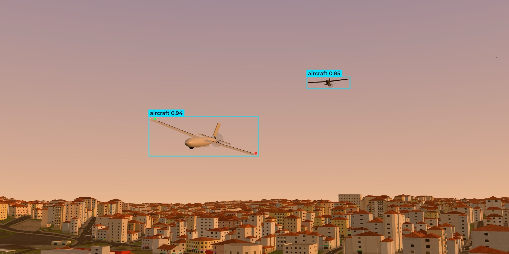

  
   
  <picture>
    <source media="(prefers-color-scheme: dark)" srcset="assets/logo-tiremo-vision-dark.svg">
    
  </picture>

<h1 align="center">Air-to-All-Around Vision Tracking</h1>

  <b>Versal AI Edge VEK280</b> 
  An AI drone flies by its camera alone and decides 60 times a second

  
  
  
  

  
   
  The AI drone's view: two aircraft over the simulated town, detected on the NPU

## Summary

A person flies a drone through a simulated town. A second drone, controlled by AI, has nothing but its own camera to go on. The VEK280 receives that camera feed over HDMI 2.1, detects aircraft and ground objects with a YOLOv8s model on its AI Engine NPU (neural processing unit), and sends flight commands back over Ethernet 60 times a second, either to chase the other drone or to escape from it. One screen shows the human pilot's view, the other shows what the AI drone sees, with its detections and tracking state.

## Highlights

- Seeing, deciding and acting run on one Versal AI Edge device, with flight commands sent back at 60 Hz.
- The board is never told where the other drone is. It works from vision alone.
- In Interceptor mode the AI drone chases, in Hunter mode it escapes, as a quadcopter or a fixed-wing aircraft.
- The heavy layers run in INT8 and the detection heads in BF16, which keeps accuracy where it matters.
- The detectors were trained on open real-image datasets. The simulator is only used for testing.

## Specifications

| Category | Details |
|:--|:--|
| Use cases | vision-based drone pursuit and evasion, ADAS perception testing |
| Target markets | counter-UAV, drone autonomy, ADAS testing |
| Platform | VEK280 evaluation board, Versal AI Edge VE2802 |
| Compute | AI Engine NPU (304 AI Engines at 450 MHz), 2× Arm Cortex-A72, programmable logic for video I/O |
| Models and algorithms | YOLOv8s at 768×576 in INT8 and BF16 (13 classes), tracker with velocity prediction, chase and escape control law |
| Inputs | HDMI 2.1 with the simulated drone camera at 1080p60, optional GNSS, IMU and airspeed |
| Outputs | HDMI 2.1 AI view at 1080p, flight commands over Ethernet (UDP, 60 Hz) |
| Software and tools | Vitis AI 6.1, Vivado, Vitis and PetaLinux 2025.2, C++ application, Three.js simulator |
| Data | open real-image datasets for training, the simulated town for testing |

## System

1. The simulator PC renders the AI drone's camera view and sends it at 1080p over HDMI 2.1.
2. The HDMI 2.1 receiver in the programmable logic writes each frame to LPDDR. All engines share this memory through the network on chip.
3. The Arm cores crop the model's region of the frame, scale it and quantize it once.
4. The AI Engine NPU runs YOLOv8s, including box decoding, so the Arm cores get a ready table of boxes.
5. The Arm cores run NMS, tracking and the chase or escape law, which turn the detections into a flight command.
6. The AI view goes out on HDMI 2.1, and the command returns to the simulator over Ethernet at 60 Hz.

## Performance

| Metric | Value | Conditions |
|:--|:--|:--|
| Display rate | 60 FPS | HDMI 2.1 in and out at 1080p60, every input frame inferred once |
| Inference | 6.6 to 8.7 ms per frame | input preparation, NPU and decode, YOLOv8s at 768×576, mixed precision |
| NPU execution | 3.7 to 5.3 ms per frame | same model |
| Control loop | 60 Hz | flight commands from the board to the simulator over UDP |

## Development

The system has three layers. The hardware platform has HDMI 2.1 receive and transmit paths with the NPU linked in, built with Vivado, Vitis and PetaLinux 2025.2. On top of it runs a Linux image with the Vitis AI 6.1 runtime and a C++ application on the Arm cores. The detector is trained in PyTorch on a PC, then Vitis AI quantizes and compiles it into an NPU snapshot that the application loads at start-up. The simulator is a Three.js town that renders the AI drone's camera and flies it with the commands from the board.

A few problems were solved along the way:

- Reading the NPU's raw outputs and decoding them in C++ keeps the display at 60 FPS. The generic post-processing path gives the same boxes at about 40 FPS.
- Moving the scaling step to the Arm NEON vector unit cut it from 5.6 ms to 3.2 ms per frame.
- Velocity prediction in the tracker cut the share of boxes left behind in a fast pan from 63 % to 23 %.
- The capture stage checks every frame for RGB or YCbCr, so a source that switches colour mode no longer turns the picture green.

Next, crop, scaling and colour conversion will move from the Arm cores into a programmable logic kernel, which makes higher-quality scaling possible at 60 FPS.

## Setup

- VEK280 evaluation board, which runs capture, inference, tracking and control
- Simulator PC, which renders the town and both drones and sends the AI drone's camera over HDMI 2.1
- Gamepad for the human pilot
- Two monitors, one for the pilot's view and one for the AI view from the board
- Ethernet link for the flight commands

## Resources

- [VEK280 evaluation board](https://www.amd.com/en/products/adaptive-socs-and-fpgas/evaluation-boards/vek280.html): board overview and documentation
- [Versal AI Edge series](https://www.amd.com/en/products/adaptive-socs-and-fpgas/versal/ai-edge-series.html): the device family
- [AI Engine-ML architecture manual (AM020)](https://docs.amd.com/r/en-US/am020-versal-aie-ml): how the AI Engines work
- [Vitis AI documentation](https://vitisai.docs.amd.com/): from a trained model to the NPU
- [YOLOv8](https://docs.ultralytics.com/models/yolov8/): the detector family
- [three.js](https://threejs.org/): the 3D engine behind the simulator

## Related demos

- [Air-to-Ground Surveillance](../alinx-z7a-air-to-ground-surveillance/): four drone cameras and one person detector on the NPU
- [ADAS Multi-Task Perception](../kv260-adas-multitask-perception/): five perception tasks in one network at 30 FPS
- [One PCIe Card, Many Accelerators](../deico-z7015-pcie-accelerator-switching/): FPGA accelerators swapped over PCIe in about 3 s

## Contact

Questions about this demo: [ai@empa.com](mailto:ai@empa.com)

Product names are trademarks of their respective owners. Last updated 2026-11.
