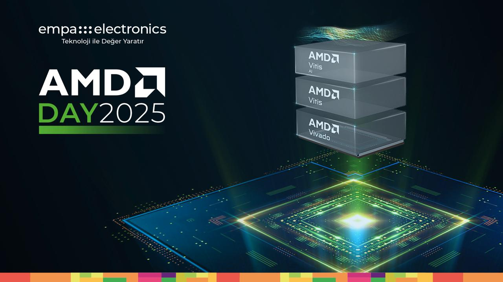

    

# AMD DAY 2025 by Empa Electronics  

## Merhaba!
Empa Electronics tarafından düzenlenen Tech Days etkinliklerimizin yeni adımı AMD DAY 2025'e hoş geldiniz. Bu açık-kaynaklı repository, Tech Day etkiliğimizde paylaşılan kaynaklara kolaylıkla eşlik edebilmeniz için sizinle paylaşılmıştır.

**Uçta Yapay Zeka**  
Bir uygulama için geliştirilen yapay zeka çözümlerinin işletilmesi modern sistemlerde iki farklı türde yapılabilmektedir. Bunlardan biri olan bulutta yapay zeka, bir yapay zeka modelinin bulut sunucu üzerinde (örneğin AWS/Azure gibi platformlarda) tesisi ve bu modele gönderilen veri örnekleri için alınan tahminlerin tekrar göndericiye iletilmesi usulüyle çalışmaktadır. Bir diğer alternatif olan uçta yapay zeka, bir modelin doğrudan çözüm için kullanılan bir uç birimde (_edge device_, örneğin: sensör kartı) tesis edilmesi ve girdi veriler için elde edilen tahminlerin doğrudan aynı platform üzerinde elde edilebilmesidir. Uçta yapay zeka çözümleri, verinin tahminleme için başka bir platforma gönderilmemesi sayesinde başta düşük gecikme, düşük bant genişliği, düşük güç tüketimi ve veri gizliliği gibi pek çok fayda sağlamaktadır.

## Canlı Demo  

Canlı demo gösterimine katılım için herhangi bir kurulum ihtiyacı yoktur. Demo kaynak dosyaları, uygulama içeriklerinin incelenmesi ve etkinlik sonrası referans materyal olarak kullanımı amacıyla paylaşılmaktadır.

### ↳ [Vitis-AI ile AMD FPGA Platformlarında AI Uygulamaları Geliştirme](Applications/Building_AI_Solutions_with_Vitis_AI/)  

Yapay zeka çözümlerinin FPGA tabanlı AMD platformlarında kullanımının uygulamalı anlatımını içerir. Bu aktivite, interaktif olarak yapılmayacak olup yalnızca konuşmacıların uygulamalı anlatımı içerir. Aktivite kaynağı olarak sağlanan içerikler, etkinlik sonrası deneyimleme amaçlıdır.

## Uyarılar  

Aktivite çalışma ortamlarının kurulumlarıyla ilgili soru ve taleplerinizi **ai@empa.com** adresine iletebilirsiniz.
